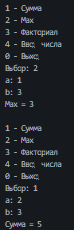

# Практическая работа №8

**ФИО:** Сташенко Дмитрий Николаевич 
**Группа:** ИСП-243  
**Дата:** 13.11.2026

## Что изучено

- Метод `void` только выполняет действие и ничего не возвращает, а метод с типом результата (например, `int`) обязан вернуть значение через `return` на любом пути выполнения.
- Параметры позволяют передавать данные в метод, поэтому один и тот же метод работает с разными аргументами: `Max(3, 5)` и `Max(10, 2)` — код не дублируется.
- Повторяющийся код выносится в отдельный метод: исправлять его нужно в одном месте, а не в нескольких копиях (пример — `ToFahrenheit` вместо трёх одинаковых формул).

## Скриншоты

